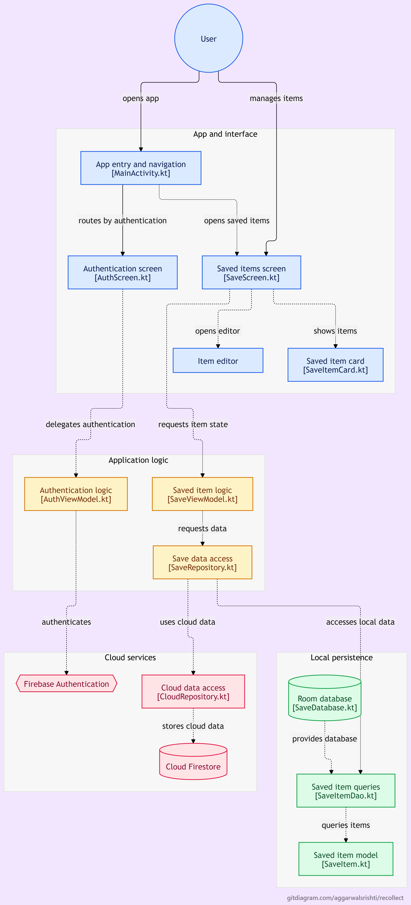

# Recollect — Personal Save-for-Later App

**BYTE MAIT App Development Recruitment Task**

Recollect is an Android application that helps users save notes, links, and images for later reference. It supports local storage using Room and cloud storage using Firebase, allowing users to access their saved items across devices after signing in.

## Features

### Stage 1 — Local Save-for-Later

- Create, view, edit, and delete saved items.
- Save notes, links, and images.
- Add tags to organize saved content.
- Search and filter saved items.
- Archive items and restore them when needed.
- Store items locally using Room Database so they persist across app restarts.

### Stage 2 — Authentication and Cloud Storage

- Sign up and sign in using email and password.
- Authenticate users using Firebase Authentication.
- Store user-specific items in Cloud Firestore.
- Associate saved items with their respective owners.
- Access saved items after signing in on another device.
- Handle cloud synchronization and retry pending sync operations.
- Keep local data available when cloud synchronization is temporarily unavailable.

### Additional Feature — Android Share Integration

- Share text and links from other apps into Recollect.
- Receive shared content through Android's Share menu.
- Open the item editor with the shared content prefilled.
- Share images into Recollect for saving.

## Tech Stack

- **Language:** Kotlin
- **UI:** Jetpack Compose
- **UI Components:** Material 3
- **Local Database:** Room
- **Authentication:** Firebase Authentication
- **Cloud Database:** Cloud Firestore
- **Architecture Components:** ViewModel, Kotlin Coroutines and Flow
- **Android Integration:** Intents and Activity Result APIs

## Architecture Diagram

The following diagram illustrates the main components of Recollect and how the UI, application logic, local database, and Firebase services interact.



## Project Structure

The project follows a package-based structure to separate the UI, application logic, data access, and cloud functionality.

```text
com.example.recollect/
├── data/
│   ├── cloud/
│   │   └── CloudRepository.kt
│   └── room_database/
│       ├── SaveDatabase.kt
│       ├── SaveItem.kt
│       └── SaveItemDao.kt
├── repository/
│   └── SaveRepository.kt
├── ui/
│   └── screens/
│       ├── AuthScreen.kt
│       ├── ItemEditorDialog.kt
│       ├── SaveItemCard.kt
│       └── SaveScreen.kt
├── viewmodel/
│   └── AuthViewModel.kt
│   └── SaveViewModel.kt
└── MainActivity.kt
```

## Getting Started

### Prerequisites

- Android Studio
- Android SDK compatible with the project's Gradle configuration
- A Firebase project
- An Android emulator or physical Android device

### Setup

1. Clone the repository:

   ```bash
   git clone <YOUR_GITHUB_REPOSITORY_URL>
   ```

2. Open the project in Android Studio.

3. Configure Firebase for the Android application and place the `google-services.json` file in the app module directory, as required by the Firebase setup.

4. In the Firebase Console, enable **Email/Password** under Authentication sign-in providers.

5. Set up Cloud Firestore and configure its security rules to ensure users can access only their own saved items.

6. Allow Android Studio to sync the Gradle project.

7. Build and run the app on an emulator or connected Android device.

## Technical Decisions

- **Room for local persistence:** Room provides structured local storage and allows saved items to remain available after the application is closed or restarted.
- **Jetpack Compose for the UI:** Compose is used to build the app screens and interactive components using Kotlin.
- **ViewModel and repository separation:** ViewModels manage screen-related state and application actions, while repositories handle data access.
- **Firebase Authentication:** Email/password authentication provides account-based access without requiring a custom authentication backend.
- **Cloud Firestore:** Firestore stores user-specific saved items and supports accessing cloud data from multiple devices.
- **Local-first data handling:** Local persistence allows users to retain access to saved content even when cloud synchronization is unavailable. Pending cloud operations can be retried.
- **Android share intents:** Share intents allow supported content from other apps to be passed into Recollect and prefilled in the item editor.

## Known Limitations

- Image sharing and image saving rely on URI access provided by Android. Access to an image may depend on whether the URI permission remains valid.
- Cloud functionality requires a correctly configured Firebase project and appropriate Firestore security rules.
- Conflict resolution during simultaneous edits across devices is limited and may not cover every possible synchronization scenario.
